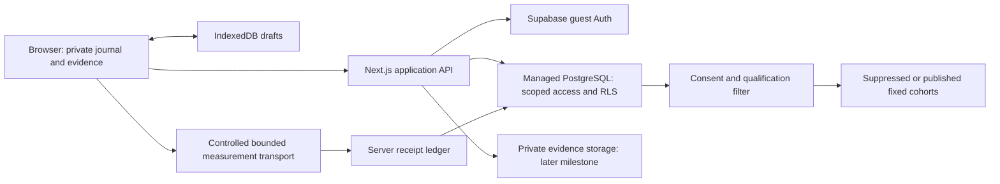

# CTO Directive 001 — canonical proposal baseline

Baseline ID: **CTO001-r1**. Document version: **0.1.0**. Date: 2026-11-16. Status: **PROPOSED — awaiting CTO review and recorded founder decisions**. No implementation or publication approval is implied.

The CTO's Approve with Changes verdict authorizes resolution of six mandatory findings and documentation. It does not approve every numeric limit or technical choice below. “CTO direction” means an explicit requirement in Directive 001. “Recommended default” means the architecture coordinator's proposal responding to that direction, not an invented CTO endorsement. “Founder pending” is recorded in the decision register. ADR acceptance and implementation authorization are separate events.

## Reading order and authority

1. Root AGENTS.md: product boundaries, coordination and safety rules.
2. This index and [founder decisions](founder-decisions.md): version, status and unresolved approvals.
3. ADRs: [001 stack](adr-001-web-and-data.md), [002 ownership](adr-002-guest-ownership.md), [003 evidence](adr-003-private-evidence.md), [004 measurements](adr-004-measurement-boundary.md), [005 privacy](adr-005-data-lifecycle.md), [006 publication](adr-006-publication.md).
4. Contracts: [common semantics](../contracts/common.md), [domain](../contracts/domain.md), [HTTP API and schemas](../contracts/api-v1.md), [sessions](../contracts/auth-sessions.md), [evidence/deletion](../contracts/evidence-lifecycle.md), [publication](../contracts/aggregation.md).
5. Measurement: [method](../measurement/browser-http-v0.1.md), [receipts](../measurement/receipt-v0.1.md).
6. [Privacy decision matrix](privacy-decision-matrix.md), [roadmap](implementation-roadmap.md), [Antigravity handoff](antigravity-handoff.md), [review record](review-record.md).

Explicit current user/CTO authorization governs task scope. Product/security invariants in AGENTS.md remain binding. Accepted ADRs define architecture; approved versioned contracts define exact interfaces within those decisions; the measurement specification owns metric definitions. A draft cannot override an accepted decision. A newer date is not approval. If accepted artifacts conflict, stop the dependent change, record the conflict and obtain coordinated review; do not silently choose one. The historical audit is rationale, not a competing interface specification.

Only one canonical definition per concern: HTTP field shapes in api-v1.md; shared scalars/errors in common.md; ownership relations in domain.md; lifecycle in auth-sessions.md and evidence-lifecycle.md; metric semantics in measurement/; publication algorithm in aggregation.md; duration values in privacy-decision-matrix.md. Cross-links reference these definitions rather than creating alternative enums or defaults.

## Change and approval protocol

Codex owns backend contracts and integration coordination. Antigravity reviews frontend usability before frontend execution. Changes require an ID/revision, rationale, affected clients, migration/compatibility impact, acceptance examples, security review evidence and acknowledgement by affected owners. Founder decisions are required for changed data uses, recovery promises, retention, costs and public claims. CTO accepts the technical baseline. No approvals are recorded yet for CTO001-r1.

All documents in this tree are part of proposed revision 0.1.0 unless stated otherwise. Changes during review increment the baseline revision with a change log. Once accepted, retain immutable approved revisions via authorized version control and record supersession; never silently alter deployed API/method semantics. No commit is authorized in this mission.

## Architecture outline

One application and database; a separately configurable measurement boundary can be colocated if validated. No PostGIS, maps, new runtime AI, native collector, queue platform or microservices are required by this baseline.
