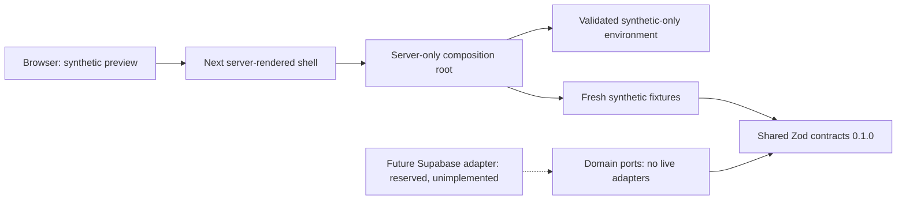

# CTO002-A foundation record

Implementation revision: CTO002-A-r1. Date: 16 November 2026. Source baseline: main at 5ea102175c76ccf44120a5d45ae78de0fcc83fe2. No commit, push or deployment is authorized.

## Authorization and preservation

The CTO provisionally accepted CTO001-r1 for local foundation work. Its 20 architecture, contract and measurement files remain byte-for-byte intact. Their historical PROPOSED headers and the F01 scaffolding gate are read alongside the newer explicit CTO002-A authorization. This authorizes the local Next/React/TypeScript stack, not a production provider, region, budget, privacy notice, retention promise or measurement launch. AGENTS.md is amended while preserving its enduring product and engineering rules.

The repository initially contained no application to replace. Existing uncommitted documentation is preserved; no Antigravity implementation was present. Implementation is deliberately a single modular app with ports, not services or speculative persistence entities.

## Toolchain decisions

All direct versions are exact pins; package-lock.json pins the transitive graph.

| Tool | Version | Reason |
| --- | --- | --- |
| Node / npm | 26.12.1 / 11.20.0 | Installed LTS runtime, one reproducible package manager, engine guard and CI parity |
| Next / React / React DOM | 16.4.6 / 19.3.1 / 19.3.1 | App Router and server components; minimal client surface |
| TypeScript | 6.0.3 | Strict compiler and stable compiler API compatible with the selected TypeScript ESLint parser |
| Tailwind / PostCSS plugin | 4.3.5 / 4.3.5 | Local compiled styles; no UI framework dependency |
| PostCSS | 8.5.33 | CSS processing |
| Zod | 4.6.7 | Runtime schemas and inferred types share one definition |
| ESLint / @eslint/js | 10.15.0 / 10.0.1 | Supported ESLint line |
| typescript-eslint | 8.72.2 | Declares ESLint 10 and TypeScript <6.1 compatibility |
| @next/eslint-plugin-next / eslint-plugin-react-hooks | 16.4.6 / 7.1.1 | Framework and hook checks without incompatible bundled React lint plugins |
| Vitest | 5.1.0 | Fast local Node-based unit/contract tests; no browser test framework required for this static shell |
| yaml / server-only | 2.9.1 / 0.0.1 | CI parsing and Next build-time server boundary |
| @types/node / react / react-dom | 26.6.6 / 19.3.0 / 19.3.0 | Runtime/type-family alignment |

The first latest-version combination exposed peer incompatibilities: eslint-config-next includes React/import plugins capped at ESLint 9, which is already EOL. The final config uses supported ESLint 10 and direct Next/React Hooks/TypeScript rules. It does not claim complete automated JSX accessibility coverage; future interactive UI needs browser/accessibility tests. TypeScript 7's changed compiler API and the parser's <6.1 bound make TypeScript 6 the compatible choice. No peer overrides or legacy-peer-deps are used.

References checked during selection: [Next installation](https://nextjs.org/docs/app/getting-started/installation), [Node release lines](https://nodejs.org/en/about/previous-releases), [Tailwind Next integration](https://tailwindcss.com/docs/installation/framework-guides/nextjs), [Vitest guide](https://vitest.dev/guide/), [ESLint support](https://eslint.org/version-support/). Exact versions and peer ranges were checked through npm registry metadata. CI pins [checkout v7.0.1](https://github.com/actions/checkout/releases/tag/v7.0.1) and [setup-node v7.1.0](https://github.com/actions/setup-node/releases/tag/v7.1.0) to release commit SHAs.

## Architecture and trust boundaries

No Supabase SDK, client, service credentials, database connection, storage bucket, migration, auth cookie or network measurement exists. Future provider adapters implement ports behind the server boundary; they must not redefine DTOs or leak database rows. Ports describe architecture, not implemented services. No successful persistence stub is provided.

The preview reads fixtures on the server and emits labelled public synthetic content. There are no private pages or responses yet. Static prerendering is appropriate only for this nonprivate shell; future private pages must explicitly adopt the approved no-store/dynamic policy. Environment validation runs when the composition root executes (including build prerender), not as a claim of per-request production environment enforcement.

Contracts validate shape and selected pure invariants. Future HTTP adapters must validate body/content type/size, origin/CSRF, authorization, idempotency, catalog membership and rate limits independently. No schema can certify ownership, authentic receipts, independent contributors or publication eligibility.

## Review evidence and remaining gates

Author self-review covers forbidden client imports, server-only guards, fail-closed synthetic configuration, safe error envelopes, request ownership rejection, unknown enum rejection, unavailable metric nulls and fixture labelling. Negative tests exercise those boundaries. Module checks include transitive re-exports and relative imports; they are repository guardrails, not an adversarial JavaScript sandbox. Bundle inspection checks known markers, not all possible secrets. No credentials were supplied.

DeepSeek V4 Pro ran a continuation review on 16 November 2026 during the CTO002-A recovery: it re-verified repository state, CTO001-r1 preservation, contract coherence, module boundaries, dependency/audit posture and the full quality suite. That is the assigned specialist-review pass, not an independent second reviewer or third-party security audit. No Antigravity usability acknowledgement is claimed. RLS, auth/CSRF, storage isolation, receipt forgery/replay, deletion jobs and public suppression are not implemented or tested.

F01 provider/region/cost, F02 guest recovery, F03 privacy/retention/deletion, F04 calibrated measurement and budget, F05 public claims, F06 attachments and F07 official-source editorial ownership remain gated as documented. Fixture expiry dates illustrate the proposed DTO and do not approve retention durations.

Dependency audit on 16 November 2026: production dependencies report zero known advisories; the full graph reports seven moderate entries stemming from one development-only minimatch advisory, [GHSA-g3hv-75wg-m249](https://github.com/advisories/GHSA-g3hv-75wg-m249). No high/critical entries were reported. The advisory requires attacker-controlled patterns with optimizationLevel >=2. The installed typescript-estree call uses only dot:true, minimatch defaults to level1, and this project does not enable the project-service path that consumes allowDefaultProject globs. This supports limited exposure in the present configuration; it is not a vulnerability fix. Do not force npm's suggested downgrade to incompatible old tooling or silently override a major transitive version. Codex must recheck for a compatible upstream fix before changing lint/project-service configuration or accepting broader untrusted CI execution; retain the advisory as an open maintenance risk.

## Delivery sequence

1. This foundation: local shell, stable typed subset, fixtures, reproducible checks.
2. Antigravity acknowledges contract usability and owns authorized UI work through sequential integration.
3. Separately authorize incident drafts, reviewed guest ownership and private journal persistence; add RLS/CSRF/rate-limit/idempotency tests before integration.
4. Validate owner-authorized text-only JSON/PDF evidence and factual complaint templates before attachments. Measurements are not a dependency.
5. Implement separately approved measurement transport/calibration and private preservation.
6. Implement secure uploads only after quarantine/scanning/access review.
7. Keep public numerical results unavailable until all consent, calibration, abuse and privacy gates pass. Official guidance needs a reviewed content contract.

Verification results and exact changed-file inventory are in the delivery report; no test result is inferred from this design record.
