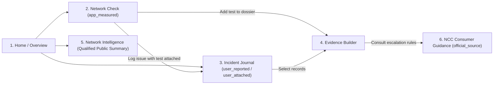

# SignalPulse NG — UX & Information Architecture

> **Document ID:** `CTO002-B-02`
> **Status:** Proposed (Awaiting CTO Review)
> **Owner:** Antigravity (Principal Frontend Engineer & Product Design Lead)
> **Scope:** Product flow ("Measure -> Document -> Preserve Evidence -> Take Action"), navigation architecture, URL routing, offline/local state taxonomy, and provenance boundaries.

---

## 1. Core Experience Loop

SignalPulse NG is structured around a calm, linear four-stage subscriber empowerment loop that also supports direct entry into any stage:

1. **Measure (`Network Check`):** Subscriber selects operator + Lagos LGA, confirms mobile data, reviews configuration-driven data budget and timeout parameters (`MAX_TEST_BYTES_CONFIG`, `MAX_TEST_DURATION_MS_CONFIG` — calibrated before production), and runs a bounded HTTP latency and download throughput check.
2. **Document (`Incident Journal`):** Subscriber logs a structured service incident across one of the six provisional CTO001-r1 incident categories, optionally linking a recent `Network Check` or attaching a redacted screenshot, with full offline draft persistence.
3. **Preserve Evidence (`Evidence Builder`):** Subscriber selects relevant measurements and incidents, reviews explicit provenance labels, fills a factual complaint template, and previews/exports a private timestamped PDF or JSON dossier.
4. **Take Action (`NCC Consumer Guidance` & `Network Intelligence`):** Subscriber follows the two-step official escalation protocol (Operator Complaint Reference first -> NCC 622 / Consumer Portal second) and views privacy-protected Lagos area summaries only when the backend issues a `published` state.

---

## 2. Information Architecture & Route Map

To avoid overcrowding small mobile viewports (`320px–375px`), the application uses a **5-slot mobile bottom navigation bar** for high-frequency actions, while surfacing **NCC Consumer Guidance** prominently in the top header bar, on the Home overview, and inside the Evidence Builder and Incident Journal completion cards. On desktop (`>= 1024px`), all six primary product areas appear in the persistent left navigation rail.

| Area # | Product Area | Proposed Route | Primary Provenance Types | Mobile Nav Location | Desktop Nav Location |
| :--- | :--- | :--- | :--- | :--- | :--- |
| **1** | **Home / Overview** | `/` | All (Explainer) | Bottom Tab 1 (`Home`) | Left Rail Item 1 |
| **2** | **Network Check** | `/check` | `app_measured`, `device_observed` | Bottom Tab 2 (`Check`) | Left Rail Item 2 |
| **3** | **Incident Journal** | `/incidents` | `user_reported`, `user_attached` | Bottom Tab 3 (`Journal`) | Left Rail Item 3 |
| **4** | **Evidence Builder** | `/evidence` | Multi-source Dossier | Bottom Tab 4 (`Evidence`) | Left Rail Item 4 |
| **5** | **Network Intelligence** | `/intelligence` | Qualified `app_measured` / `user_reported` | Bottom Tab 5 (`Area Data`) | Left Rail Item 5 |
| **6** | **NCC Consumer Guidance** | `/guidance` | `official_source` | Top Header Pill (`NCC Guide`) + Contextual CTAs | Left Rail Item 6 |

---

## 3. Navigation & Shell Behavior

### 3.1 Top Trust & Status Header (All Viewports)
- **Left:** SignalPulse NG wordmark + subtle `"Lagos v0.1"` geography badge.
- **Right:**
  - **Connection/Queue Pill:** Displays live browser online/offline state (`Online` vs `Offline — Local Drafts Active (N)`).
  - **NCC Guidance Quick-Link (`< 1024px`):** Compact `"NCC Rights"` pill button (`min-height: 40px`, hit area `48px`) for one-tap access to `/guidance` from anywhere.

### 3.2 Mobile Bottom Navigation Bar (`< 1024px`)
- Fixed to bottom (`height: 64px` + `env(safe-area-inset-bottom)`), high-contrast surface (`#FFFFFF`), `1px solid #DCD8D0` top border.
- 5 equal-width flex items (`min-width: 64px` on `320px` screens), each with a crisp `20px` SVG stroke icon and a single-word `11px` (`font-weight: 600`) label (`Home`, `Check`, `Journal`, `Evidence`, `Area Data`).
- Active state uses `--sp-accent-primary` (`#0B5D4C`) text/icon and a `2px` top indicator bar.

### 3.3 Desktop Left Navigation Rail (`>= 1024px`)
- Fixed left column (`width: 240px`), displaying all 6 product areas with full names (`Home / Overview`, `Network Check`, `Incident Journal`, `Evidence Builder`, `Network Intelligence`, `NCC Consumer Guidance`), plus a persistent bottom card summarizing **Local Storage & Privacy Status** (e.g., `"All drafts stored locally on this device until you submit or export"`).

---

## 4. Lagos Geography & Operator Taxonomy

### 4.1 Supported Operators (v0.1 Configurable List)
1. `mtn` — **MTN Nigeria**
2. `airtel` — **Airtel Nigeria**
3. `glo` — **Globacom (Glo)**
4. `t2mobile` — **T2mobile**

*UX Rule:* Operator selection is always labelled `"Selected Operator (User Reported)"` because a web browser/PWA cannot cryptographically read the active cellular SIM PLMN/MCC-MNC.

### 4.2 Manual Lagos Location Hierarchy (No GPS Required)
Subscribers never face a browser geolocation permission prompt in v0.1. Location selection uses a fast, keyboard-searchable two-tier selector:
1. **Lagos State LGA (20 Official LGAs):** Agege, Ajeromi-Ifelodun, Alimosho, Amuwo-Odofin, Apapa, Badagry, Epe, Eti-Osa, Ibeju-Lekki, Ifako-Ijaiye, Ikeja, Ikorodu, Kosofe, Lagos Island, Lagos Mainland, Mushin, Ojo, Oshodi-Isolo, Shomolu, Surulere.
2. **Curated Neighbourhood (Optional or Scoped per LGA):** e.g., *Ikeja -> Computer Village, Alausa, GRA Ikeja, Allen Avenue, Oregun*; *Eti-Osa -> Victoria Island, Lekki Phase 1, Ikoyi, Ajah, Jakande*; *Lagos Mainland -> Yaba, Akoka, Ebute Metta*; *Surulere -> Bode Thomas, Adeniran Ogunsanya, Ojuelegba*.

---

## 5. Offline, Local Draft & Sync State Taxonomy

Because subscribers most frequently open SignalPulse NG *during* a connectivity failure, the UI treats offline/degraded connectivity as a first-class state rather than an unexpected exception:

| Record State | Visual Badge | Storage Location | User Actions Available |
| :--- | :--- | :--- | :--- |
| `draft_local` | `LOCAL DRAFT (DEVICE ONLY)` | Browser IndexedDB | Edit fields, attach/remove local file, delete draft, include in local Evidence preview |
| `queued_sync` | `QUEUED FOR SYNC` | Browser IndexedDB Outbox | Retry sync now, revert to local-only draft, delete |
| `saved_private` | `SAVED (PRIVATE RECORD)` | Server DB (when integrated) + Local Cache | View details, include in Evidence Builder, export JSON/PDF, request deletion |
| `sync_error` | `SYNC FAILED — SAVED LOCALLY` | Browser IndexedDB | Inspect non-technical error reason, retry submission, or export offline JSON directly |
